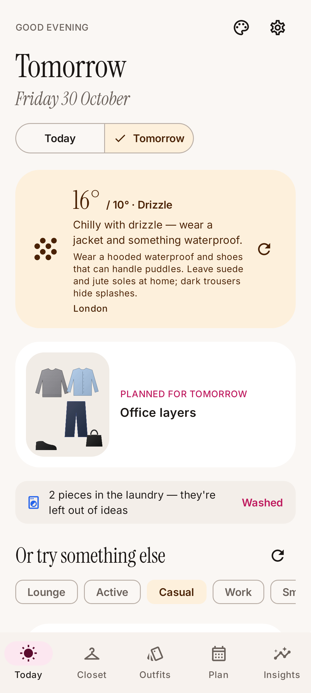
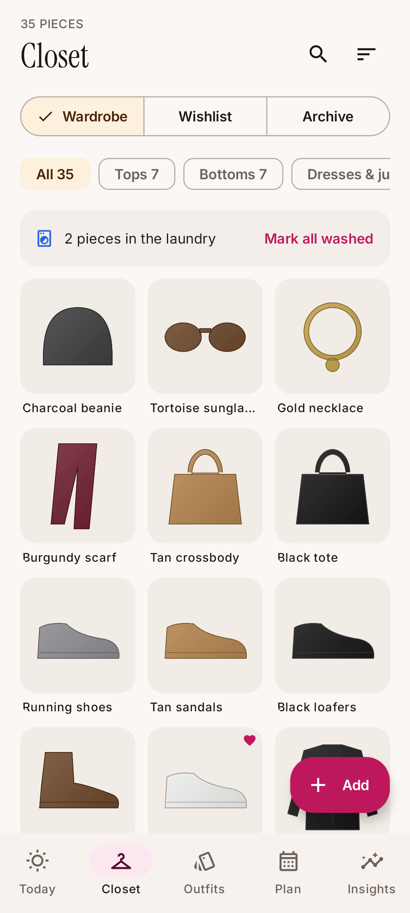
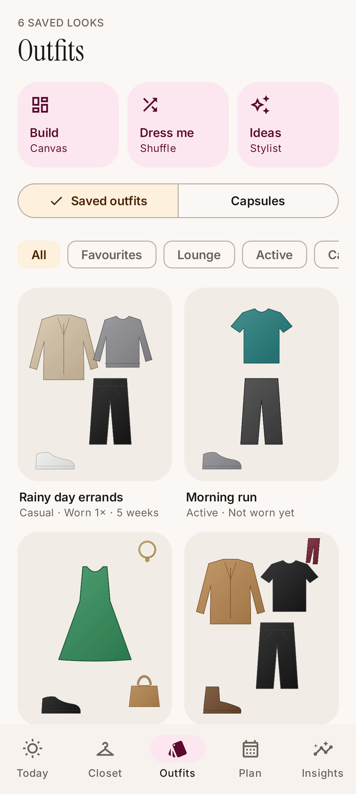
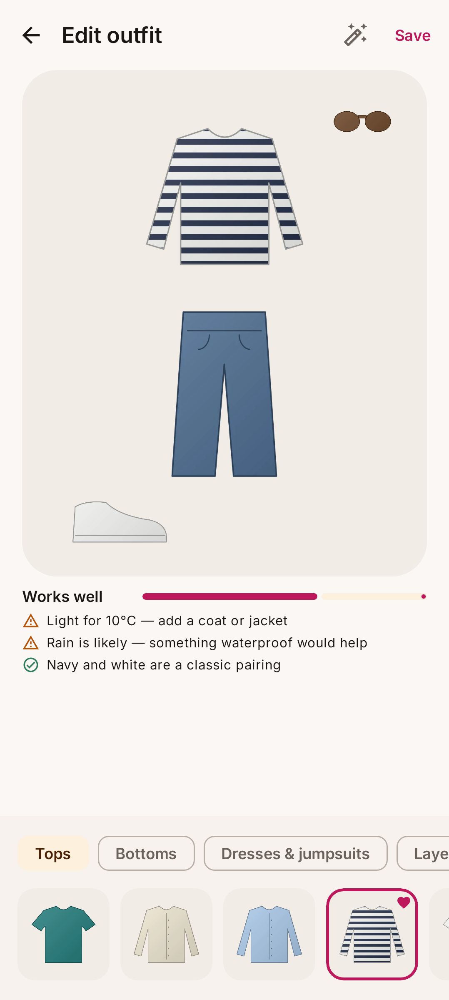
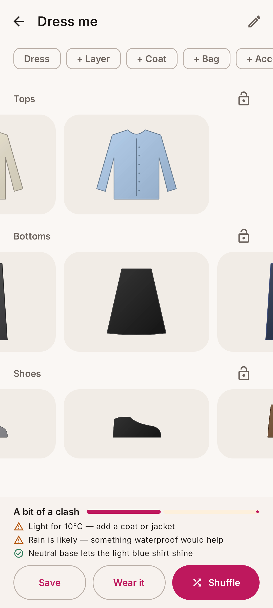
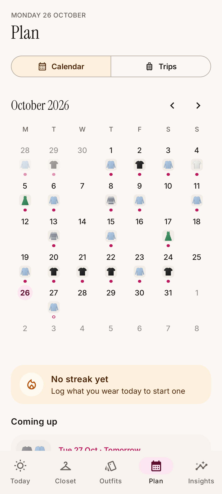
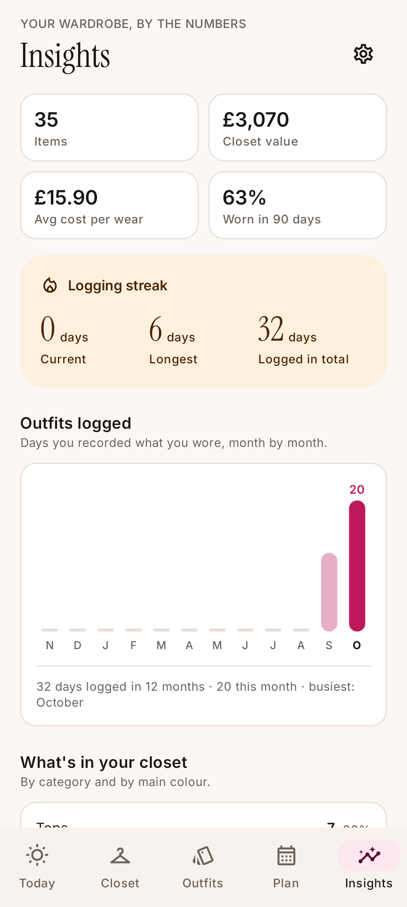
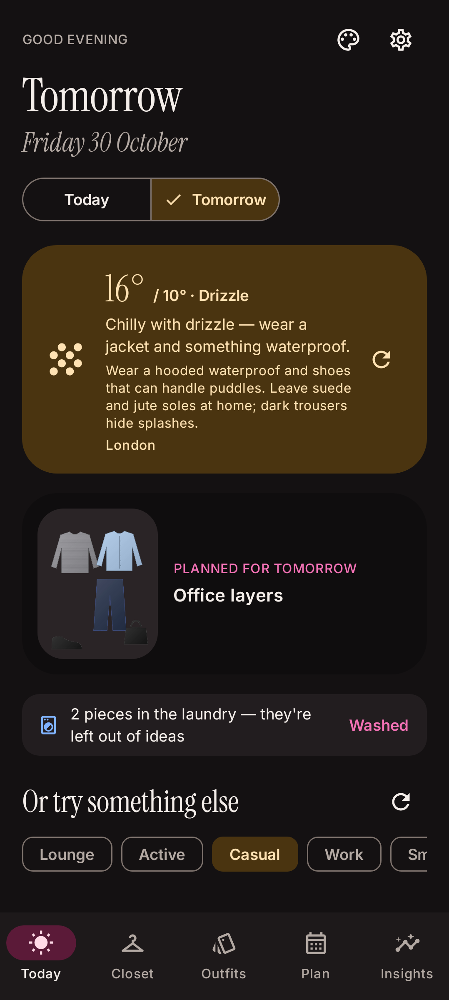

# Hanger — a personal wardrobe & outfit planner for Android

Hanger is an all-in-one digital closet, outfit planner and stylist that runs entirely on your phone.
It was designed from the [competitive research](reports/Best%20outfit%20planner%20apps%202026.md) in this repo:
it keeps the mechanics people love in Whering, Acloset, Indyx, Stylebook, Cladwell and Alta, and avoids the
things that earn them 1-star reviews (paywalls after hours of cataloguing, data you can't export, forced AI).
Its style advice comes from a researched style guide built into the app, so nothing needs an account, an API key or
a connection (apart from the weather forecast).

<p align="center">
  
  
  
  
</p>
<p align="center">
  
  
  
  
</p>

## Install it on your phone

1. On your Android phone open **[the latest release](../../releases/latest)** and download **`hanger.apk`**
   (or grab `hanger-apk` from the newest run under the repo's **Actions** tab).
2. Open the downloaded file. If Android asks, allow your browser/Files app to **install unknown apps**.
3. Open Hanger. Tap **Explore with a demo closet** to try everything with sample clothes, or **Add my first pieces** to start your own.
   You can remove the demo closet any time in Settings.

Updates install over the top and keep your data as long as they're signed with the same key.
The signing key is **never committed**. Keep the `hanger-personal.jks` you were given somewhere safe, and to let
CI publish signed builds add two repository secrets: `HANGER_KEYSTORE_BASE64` (the keystore, base64-encoded) and
`HANGER_KEYSTORE_PASSWORD`. Locally, put the same values in a git-ignored `keystore.properties`
(`storeFile`, `storePassword`, `keyAlias=hanger`, `keyPassword`). Without a key, builds use debug signing.

## What it does

**Closet**
- Add clothes from the camera or up to 30 photos at once. Backgrounds are removed **on-device** (ML Kit subject
  segmentation), the type is guessed (ML Kit image labelling) and colours are named by k-means colour extraction.
  Review and fix everything on one screen before saving.
- Add pieces without a photo and get a generated illustration (handy for wishlists).
- Rich item details: category & type presets, up to 3 colours, pattern, formality, warmth, seasons, sporty/waterproof,
  brand, size, material, price, purchase date, tags, notes.
- Search, filter (category, clean only, favourites), sort (most/least worn, longest unworn, best cost per wear, colour…),
  wishlist and archive views.
- **Laundry tracking**: each piece has a wears-before-wash count; logging an outfit moves pieces to the laundry
  automatically and suggestions skip them until you tap *Washed*.

**Outfits**
- **Canvas builder**: tap pieces to drop them on a 4:5 flat-lay, drag to move, pinch to resize/rotate, layer order,
  one-tap tidy layout, plus live stylist feedback (colour harmony, clashing patterns, formality, weather fit).
- **Dress me** shuffle (the Clueless closet): rows per category, lock what you like, smart matching, least-worn bias,
  in-season and clean-only filters.
- **Ideas**: weather-, occasion- and history-aware suggestions with stylist notes, "style this piece" around any item,
  thumbs up/down that teach the recommender.
- **Capsules**: build an edit, see how many outfits it makes and which closet piece would add the most combinations.

**Today**
- The forecast for the hours you're out (Open-Meteo, no account), what it means for your outfit, your planned look,
  fresh ideas, laundry nudges and a "forgotten gem" you haven't worn in a while. After 6pm it looks ahead to tomorrow.
- Optional morning notification and a home-screen widget with today's outfit.

**Plan**
- Calendar with wear log and planned looks, logging streaks, and a day view to plan, log, suggest, build or shuffle.
- **Trips**: destination + dates + occasions → an auto-built capsule of outfits per day (using the forecast when the
  trip is within 16 days) and a packing checklist with weather extras.

**Insights**
- Closet value, cost per wear, % of closet worn in 30/90 days, streaks, outfits logged per month, category and colour
  breakdowns, most/least/never worn, best/worst cost per wear, forgotten pieces, and how many outfits your closet makes.

**Style guide (built in, offline)**
- A researched style knowledge base ships inside the app ([what's in it and where it came from](research_notes/Style%20knowledge%202026/README.md)):
  203 rated colour pairings, 48 palettes and a profile for every colour; 125 proven outfit formulas; 236 garment
  pairings and every pattern-mixing combination; 92 styling rules; dress codes for 8 occasions and 22 invitation
  wordings; 19 weather rules and 32 fabrics; 69 dated trends for autumn/winter 2026 and spring/summer 2027; 42 closet
  checks, 85 tips and 19 essentials, all drawn from 300 cited sources.
- It drives everything: outfit scores and the notes under every suggestion ("Loafers sharpen chinos", "Proven
  formula: navy blazer, grey trousers, loafers", "On trend: chocolate and powder blue"), suggestions seeded from
  formulas that fit the occasion and season, pieces the dress code or the weather rules out, and closet insights.
- The **Style guide** screen (palette icon on Today): your closet check and tip of the day; a colour explorer showing
  what goes with each colour and how many matching pieces you own; formulas you can wear now (one tap into the
  builder) and the ones a single piece away; live and upcoming trends with the pieces you already own for each;
  and the full rules, dress codes, weather and fabric guides, essentials checklist and sources.
- Trends carry their season's dates and retire themselves. To refresh the guide, edit the research JSON and run
  `python3 tools/build_knowledge.py`; it validates everything against the app's vocabulary before bundling it.

**Your data**
- Everything is stored on the phone (Room database + app-private image folder). No account, no ads, no tracking.
- **Export / restore** the whole closet (data + photos) as one `.zip` to Drive, Downloads or anywhere.

## How it's built

| Layer | Tech |
|---|---|
| UI | Kotlin, Jetpack Compose, Material 3, Navigation Compose (type-safe routes), Instrument Serif + Inter |
| Data | Room (items, outfits + canvas placements, calendar entries, trips, packing, capsules), DataStore |
| Styling engine | Pure-Kotlin `:engine` module: colour naming/harmony, weather advisor, outfit evaluator & generator, shuffle, feedback learning, packing planner, stats, capsule maths — 105 unit tests |
| Images | ML Kit Subject Segmentation (Play services) + Image Labeling, Coil |
| Weather | Open-Meteo forecast + geocoding, offline cache |
| Background | WorkManager daily reminder, Glance widget |
| Style guide | Researched JSON knowledge base bundled in `:engine` (`tools/build_knowledge.py` validates and builds it) |

```
engine/          pure Kotlin styling engine + bundled style guide + tests
app/             Android app (data, images, weather, backup, ui/*, widget, notify)
research_notes/  the competitor research and the style-guide research (JSON + notes with sources)
tools/           build_knowledge.py: validate the research and build the bundled guide
reports/         the market research this app is based on
```

### Build locally

Requires JDK 17+ and the Android SDK (platform 35).

```bash
./gradlew :engine:test              # engine unit tests
./gradlew :app:testDebugUnitTest    # Robolectric tests: database, backup, weather, full-app walkthrough
./gradlew :app:recordRoborazziDebug # same, and writes screenshots to app/screenshots/
./gradlew :app:assembleRelease      # app/build/outputs/apk/release/hanger.apk
```

CI (`.github/workflows/android.yml`) runs all tests, builds the APK on every push and PR, and publishes it as the
`latest` release from `main`.
